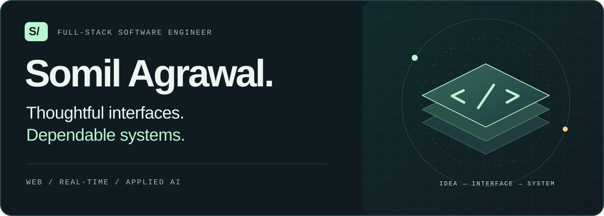
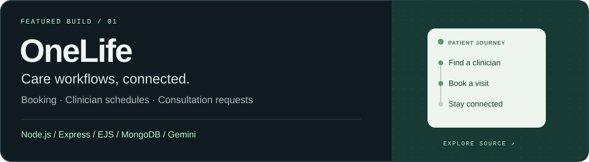
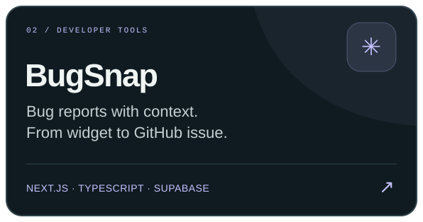
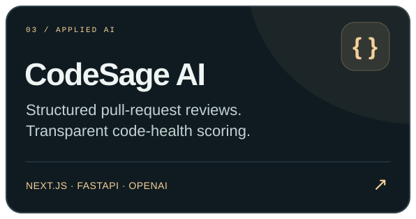
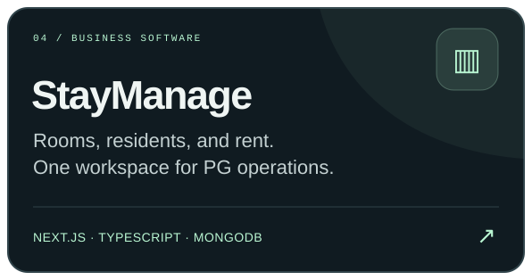
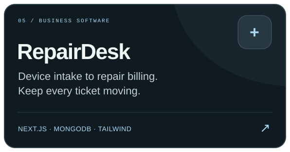
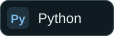
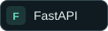
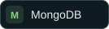
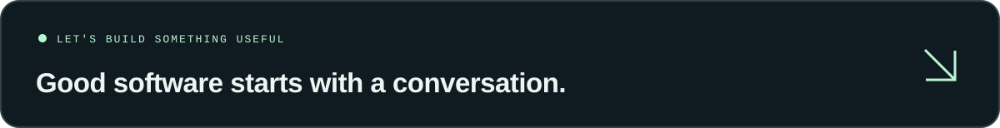

  <picture>
    <source media="(max-width: 600px)" srcset="./assets/header-mobile.svg" />
    
  </picture>

  
  &nbsp;
  
  &nbsp;
  

 

## A little about me

I'm **Somil**, a B.Tech Computer Science student at **VIT Bhopal**. I build across the stack: from responsive interfaces and APIs to data models, real-time flows, and useful AI integrations.

**Previously at Birlasoft** → REST APIs, real-time messaging, and backend optimization. 
**Currently building** → OneLife, developer tools, and business management applications. 
**Outside the build** → 700+ DSA problems solved and a completed 100-day coding challenge.

 

## Work, in focus

<a href="https://github.com/somilagrawal52/hospital-management">
  <picture>
    <source media="(max-width: 600px)" srcset="./assets/onelife-mobile.svg" />
    
  </picture>
</a>

<a href="https://somil-agrawal-portfolio.coolcarol2.chatgpt.site/work/onelife/">Read the OneLife case study ↗</a>

  
  
  
  

**Also built** &nbsp; [Chat App](https://github.com/somilagrawal52/Chat-APP) — real-time messaging &nbsp;·&nbsp; [DriveLuxe](https://github.com/somilagrawal52/Car-Rental-App) — vehicle booking

<a href="https://github.com/somilagrawal52?tab=repositories">Explore all repositories →</a>

 

## The toolkit

**Interfaces**

  
  
  
  
  

**APIs & real-time**

  
  
  
  
  

**Data, AI & delivery**

  
  
  
  
  
  
  

<strong>More of the stack</strong>

 

| Area | Additional experience |
| :--- | :--- |
| Languages & frontend | C, C++, SQL, HTML, CSS, EJS, Redux Toolkit, Vite |
| Backend & data | JWT authentication, Kafka, MySQL, Mongoose, Prisma, SQLAlchemy |
| AI & automation | scikit-learn, web scraping |
| Testing & delivery | Vitest, pytest, AWS, Render, CI/CD |

 

Open to full-stack engineering opportunities and thoughtful collaborations.

